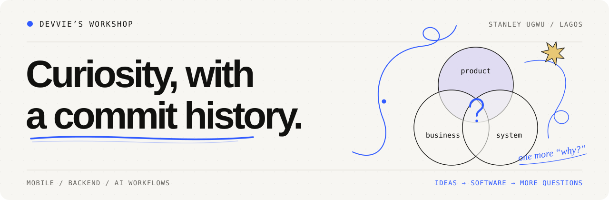
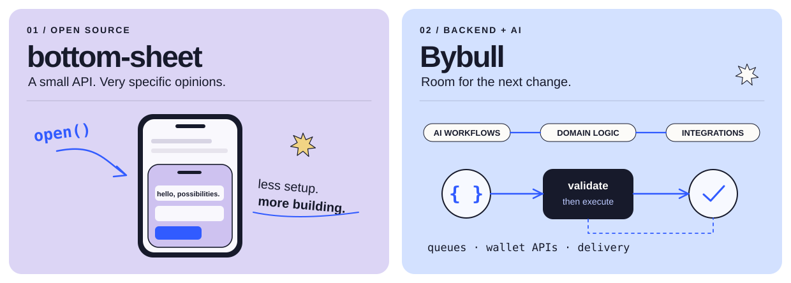
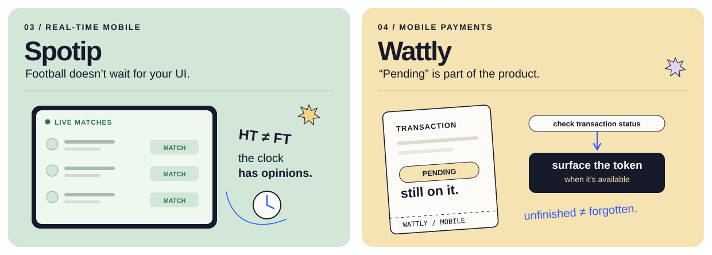

<picture>
  <source media="(prefers-color-scheme: dark)" srcset="./assets/workshop-dark.svg">
  <source media="(prefers-color-scheme: light)" srcset="./assets/workshop-light.svg">
  
</picture>

# Hey, I’m Stanley. Devvie on the internet. 👋🏾

**Product engineer · Mobile apps, backend systems & AI workflows · Lagos, Nigeria**

I build answers to questions I never finish asking. Usually as mobile apps, backend systems or libraries. Occasionally as a very long conversation.

I care about how a product feels, why it should exist, and what keeps it working. The interface and the machinery. That’s my kind of rabbit hole.

**[Step inside the portfolio ↗](https://devvie.dev)** · [Résumé](https://devvie.dev/Stanley-Ugwu-Resume.pdf) · [Say hello](mailto:hello@devvie.dev)

## A few receipts 🧾

<table>
<tr>
<td align="center" valign="top" width="33%">
<picture></picture>
<h2>51k+</h2>
monthly npm downloads 
<a href="https://www.npmjs.com/package/@devvie/bottom-sheet">package</a>
</td>
<td align="center" valign="top" width="33%">
<picture></picture>
<h2>370+</h2>
GitHub stars 
<a href="https://github.com/stanleyugwu/react-native-bottom-sheet">code</a>
</td>
<td align="center" valign="top" width="33%">
<picture></picture>
<h2>3,000+</h2>
fixtures in one matches view 
<a href="https://devvie.dev/work/spotip">Spotip</a>
</td>
</tr>
</table>

## Things that escaped my laptop

<picture>
  <source media="(max-width: 640px)" srcset="./assets/workbench-one-mobile.svg">
  
</picture>

**[01 / bottom-sheet](https://github.com/stanleyugwu/react-native-bottom-sheet)** — A dependency-free React Native component I created and maintain. Keyboard behaviour, snap points, nested scrolling. Yes, I had opinions. [Decisions ↗](https://devvie.dev/work/devvie-bottom-sheet)

**[02 / Bybull](https://devvie.dev/work/bybull)** — At Tensfer: backend foundations, exchange and wallet APIs, AI-chat workflows, queues and delivery. Making room for whatever the product becomes next.

<picture>
  <source media="(max-width: 640px)" srcset="./assets/workbench-two-mobile.svg">
  
</picture>

**[03 / Spotip](https://devvie.dev/work/spotip)** — Built the mobile app from its initial version. Live scores, caching, favourites, and a football clock with opinions of its own.

**[04 / Wattly](https://devvie.dev/work/wattly-pay)** — Built the mobile payment experience with a backend engineer: simpler top-ups, pending-transaction checks and purchased tokens. [Mobile source ↗](https://github.com/stanleyugwu/wattly-mobile/tree/develop)

## The bit between the commits

My brain keeps tabs open for **technology, philosophy, psychology and business**. They have a terrible habit of talking to each other.

> Currently poking around in **C**. “The runtime handles it” only makes me more curious.

<strong>Open the workshop drawer ↴</strong> Tools, experiments, and a few detours.

 

**Usually within arm’s reach**

TypeScript / JavaScript · React Native / Expo · Node.js / Express · PostgreSQL · Redis / BullMQ · Docker / Kamal · GitHub Actions

**A few smaller rabbit holes**

- [Card validator](https://github.com/stanleyugwu/card-validator) — a small Node.js, Express and TypeScript API using the Luhn algorithm and card-brand checks.
- [C exercises](https://github.com/stanleyugwu/alx-low_level_programming) — getting closer to the machinery.
- [DevReg](https://github.com/stanleyugwu/devReg) — an earlier smart-contract experiment: a developers’ registry.

**A thought that escaped into writing**

[Your Brilliant Idea Might Actually Suck](https://dev.to/stanleyugwu/your-brilliant-idea-might-actually-suck-1i9c) — a little less falling in love with an idea, a little more finding out whether it’s useful.

## Got something worth getting absorbed in?

I’m open to **full-time product engineering roles**, with React Native/mobile or Node.js/backend as strong starting points. If your team cares about the experience and the engineering behind it, I’d like to hear what you’re building.

**[hello@devvie.dev](mailto:hello@devvie.dev)** · [Portfolio](https://devvie.dev) · [LinkedIn](https://www.linkedin.com/in/stanleyugwu/) · [X](https://x.com/stanleyugwu_) · [Writing](https://dev.to/stanleyugwu)

Workshop remains open. Questions remain unresolved. ✌🏾
