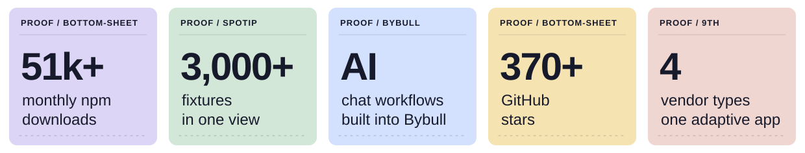
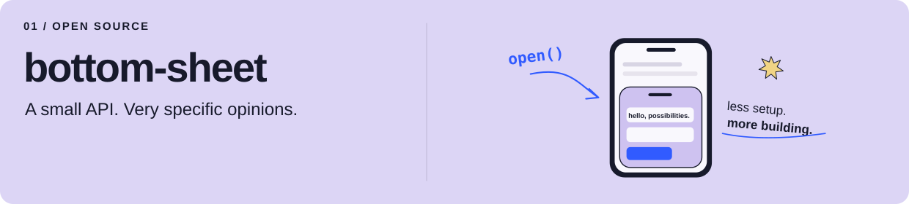
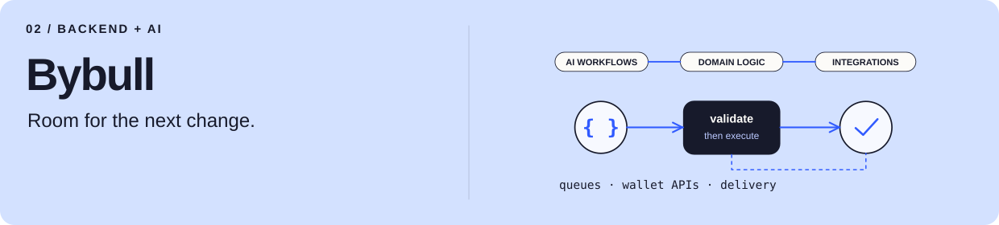
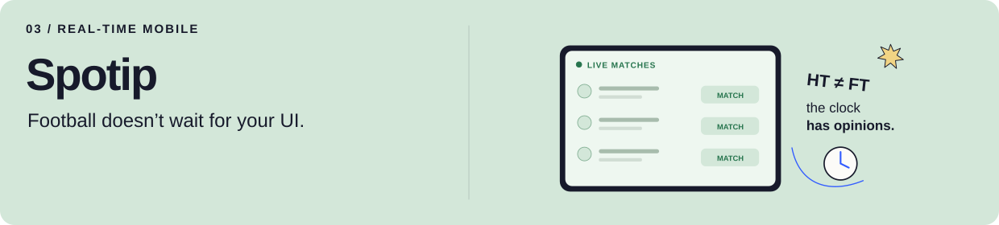
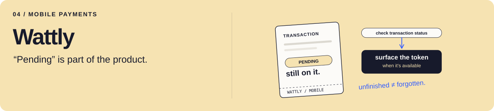
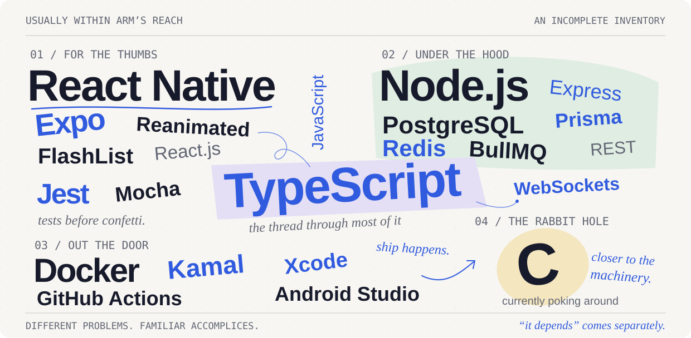

<picture>
  <source media="(prefers-color-scheme: dark)" srcset="./assets/workshop-dark.svg">
  <source media="(prefers-color-scheme: light)" srcset="./assets/workshop-light.svg">
  
</picture>

# Hey, I’m Stanley. Devvie on the internet. 👋🏾

**Product engineer · Mobile apps, backend systems & AI workflows · Lagos, Nigeria**

I build answers to questions I never finish asking. Usually as mobile apps, backend systems or libraries. Occasionally as a very long conversation.

I care about how a product feels, why it should exist, and what keeps it working. The interface and the machinery. That’s my kind of rabbit hole.

**[Step inside the portfolio ↗](https://devvie.dev)** · [Résumé](https://devvie.dev/Stanley-Ugwu-Resume.pdf) · [Say hello](mailto:hello@devvie.dev)

## A few receipts 🧾

<picture>
  <source media="(max-width: 640px)" srcset="./assets/receipts-mobile-9b34b1b60b.svg">
  
</picture>

<strong>Check the receipts ↴</strong> Numbers, context, and places to poke around.

- **51k+ monthly npm downloads** — [@devvie/bottom-sheet on npm](https://www.npmjs.com/package/@devvie/bottom-sheet).
- **3,000+ fixtures in one matches view** — [Spotip’s real-time mobile experience](https://devvie.dev/work/spotip).
- **AI-chat features built into Bybull** — integrated chat-driven workflows into the platform, with validation and controlled feature calls. [Engineering case study](https://devvie.dev/work/bybull).
- **370+ GitHub stars** — [React Native Bottom Sheet](https://github.com/stanleyugwu/react-native-bottom-sheet).
- **4 vendor types in one adaptive app** — sellers, service providers, realtors and logistics providers in [9th Vendor](https://apps.apple.com/ng/app/9th-vendor/id6793111723).

## Things that escaped my laptop

<table role="presentation">
<tr><td>
<a href="https://devvie.dev/work/devvie-bottom-sheet"><picture>
  <source media="(max-width: 640px)" srcset="./assets/project-sheet-mobile.svg">
  
</picture></a>
<h3><a href="https://devvie.dev/work/devvie-bottom-sheet">01 / bottom-sheet</a></h3>

A dependency-free React Native component I created and maintain. Keyboard behaviour, snap points, nested scrolling. Yes, I had opinions.

<a href="https://github.com/stanleyugwu/react-native-bottom-sheet">Inspect the code ↗</a> · <a href="https://www.npmjs.com/package/@devvie/bottom-sheet">Get the package</a>

</td></tr>
</table>

<table role="presentation">
<tr><td>
<a href="https://devvie.dev/work/bybull"><picture>
  <source media="(max-width: 640px)" srcset="./assets/project-bybull-mobile.svg">
  
</picture></a>
<h3><a href="https://devvie.dev/work/bybull">02 / Bybull</a></h3>

At Tensfer: backend foundations, exchange and wallet APIs, AI-chat workflows, queues and delivery. Making room for whatever the product becomes next.

<a href="https://devvie.dev/work/bybull">Backend &amp; AI case study ↗</a>

</td></tr>
</table>

<table role="presentation">
<tr><td>
<a href="https://devvie.dev/work/spotip"><picture>
  <source media="(max-width: 640px)" srcset="./assets/project-spotip-mobile.svg">
  
</picture></a>
<h3><a href="https://devvie.dev/work/spotip">03 / Spotip</a></h3>

Built the mobile app from its initial version. Live scores, caching, favourites, and a football clock with opinions of its own.

<a href="https://devvie.dev/work/spotip">Real-time mobile case study ↗</a>

</td></tr>
</table>

<table role="presentation">
<tr><td>
<a href="https://devvie.dev/work/wattly-pay"><picture>
  <source media="(max-width: 640px)" srcset="./assets/project-wattly-mobile.svg">
  
</picture></a>
<h3><a href="https://devvie.dev/work/wattly-pay">04 / Wattly</a></h3>

Built the mobile payment experience with a backend engineer: simpler top-ups, pending-transaction checks and purchased tokens.

<a href="https://devvie.dev/work/wattly-pay">Payment experience case study ↗</a> · <a href="https://github.com/stanleyugwu/wattly-mobile/tree/develop">Mobile source</a>

</td></tr>
</table>

## The usual accomplices

Good tools. Questionable number of tabs.

<picture>
  <source media="(max-width: 640px) and (prefers-color-scheme: dark)" srcset="./assets/accomplices-mobile-dark-f148a31df1.svg">
  <source media="(max-width: 640px)" srcset="./assets/accomplices-mobile-light-6fb848e3f9.svg">
  <source media="(prefers-color-scheme: dark)" srcset="./assets/accomplices-dark-8a6949c33d.svg">
  
</picture>

<strong>Read the labels ↴</strong> What lives where.

- **Mobile:** React Native, Expo, Reanimated, FlashList.
- **Backend:** Node.js, Express, PostgreSQL, Prisma, Redis, BullMQ, REST, WebSockets.
- **Across the work:** TypeScript, JavaScript, React.js.
- **Testing:** Jest, Mocha.
- **Delivery:** Docker, Kamal, GitHub Actions, Xcode, Android Studio.
- **Currently exploring:** C — [closer to the machinery](https://github.com/stanleyugwu/alx-low_level_programming).

## The bit between the commits

My brain keeps tabs open for **technology, philosophy, psychology and business**. They have a terrible habit of talking to each other.

> Currently poking around in **C**. “The runtime handles it” only makes me more curious.

<strong>Open the workshop drawer ↴</strong> Experiments and a few detours.

 

**A few smaller rabbit holes**

- [Card validator](https://github.com/stanleyugwu/card-validator) — a small Node.js, Express and TypeScript API using the Luhn algorithm and card-brand checks.
- [C exercises](https://github.com/stanleyugwu/alx-low_level_programming) — getting closer to the machinery.
- [DevReg](https://github.com/stanleyugwu/devReg) — an earlier smart-contract experiment: a developers’ registry.

**A thought that escaped into writing**

[Your Brilliant Idea Might Actually Suck](https://dev.to/stanleyugwu/your-brilliant-idea-might-actually-suck-1i9c) — a little less falling in love with an idea, a little more finding out whether it’s useful.

## Got something worth getting absorbed in?

I’m open to **full-time product engineering roles**, with React Native/mobile or Node.js/backend as strong starting points. If your team cares about the experience and the engineering behind it, I’d like to hear what you’re building.

**[hello@devvie.dev](mailto:hello@devvie.dev)** · [Portfolio](https://devvie.dev) · [LinkedIn](https://www.linkedin.com/in/stanleyugwu/) · [X](https://x.com/stanleyugwu_) · [Writing](https://dev.to/stanleyugwu)

Workshop remains open. Questions remain unresolved. ✌🏾
